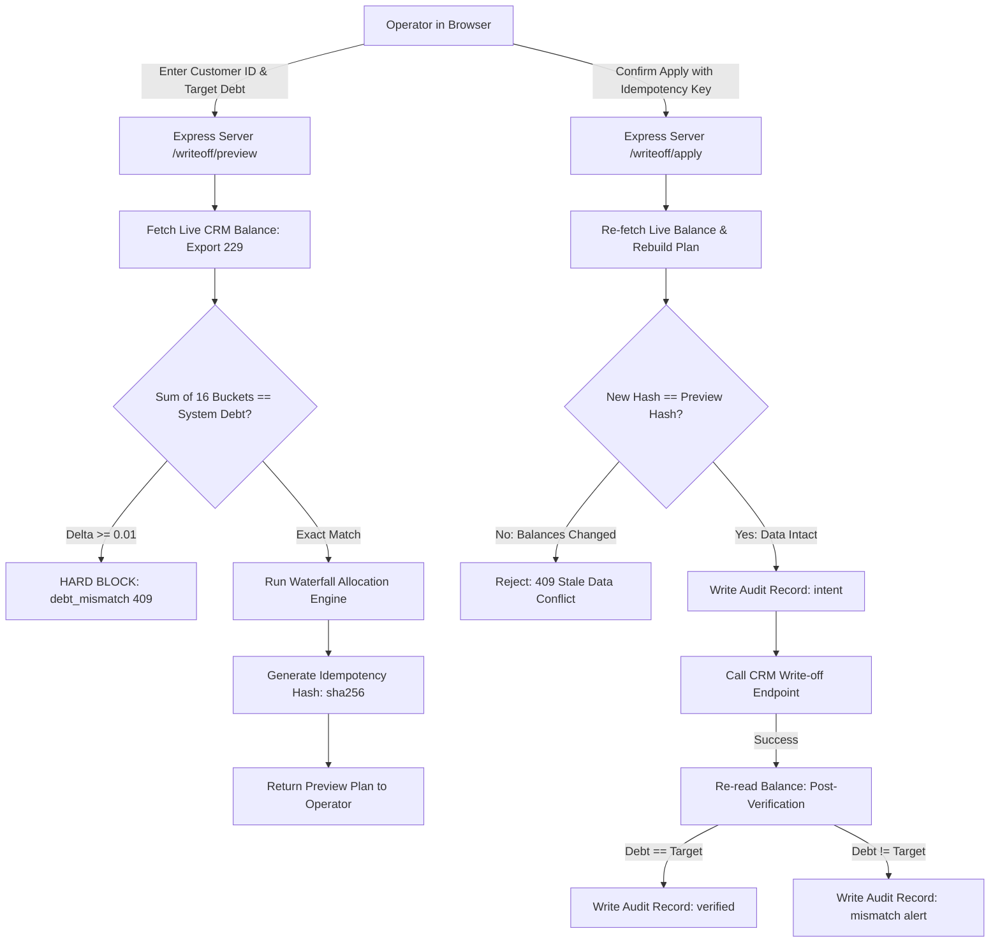

# Fintech Compliance & Debt Settlement Engine

A high-reliability financial compliance platform, multi-table loan audit viewer, and deterministic debt write-off engine built for consumer lending and microcredit operations.

Designed with **defensive programming principles**, **zero-float integer arithmetic**, **strict invariant reconciliation**, and **optimistic concurrency control**.

---

## ⚡ Executive Summary & Highlights

- **Zero-Dependency Financial Math Core**: All monetary calculations are performed in integer minor currency units (haléře/cents) to mathematically prevent IEEE 754 floating-point drift (`0.1 + 0.2 !== 0.3`).
- **Deterministic 16-Bucket Waterfall**: Debt write-offs strictly allocate `debt − target` down an enforced legal priority hierarchy (`tax12` down to `amount`).
- **Hard Invariant Reconcilation (`debt_mismatch`)**: Verifies that the sum of all 16 debt buckets exactly matches the CRM system total before moving any money. Any discrepancy $\ge 0.01$ Kč triggers a hard block (`HTTP 409`) that cannot be bypassed even with `--force`.
- **Optimistic Concurrency & Stale-Data Guard**: The server never trusts a write-off plan sent by the browser. Upon `apply`, it rebuilds the plan from live data and verifies the SHA-256 idempotency hash. If balances changed while the operator viewed the screen, the operation is rejected (`HTTP 409 Conflict`).
- **Two-Phase Append-Only Audit Logging**: Non-repudiation audit trail writes an `intent` record **before** the CRM request, followed by `applied`/`failed`, followed by an automated post-verification balance re-read (`verified`/`mismatch`).
- **49 Automated Unit Tests**: Fully self-contained test suite running in $< 300\text{ ms}$ without network or external database dependencies.
- **Hybrid Integration & RPA**: Combines REST API integration with headless Playwright browser automation for legacy CRM forms lacking public endpoints, featuring screenshot visual verification checkpoints for human-in-the-loop safety.
- **Dynamic RBAC & Instant Revocation**: Capabilities are derived per-request from persistent storage rather than stale JWT claims, ensuring instant privilege revocation for write operations.

---

## 🏗️ Architecture & Write-off Flow



---

## 🧩 Core Modules

### 1. Loan Overview & Audit (`Přehled půjček`)
Aggregates and reconciles data across CRM tables:
- **Registry & Ledger Join**: Merges loan contracts (Table 234) with granular per-transaction payment logs (Table 230).
- **Extension Chain Resolution**: Detects chains of loan extensions (`origin_id`). Properly categorizes extension fees vs net principal disbursements, eliminating duplicate principal counting across roll-overs.
- **Collection Detection**: Automatically identifies sold loans post-assignment to collection agencies.
- **Double-Counting Protection**: Distinguishes full transaction sizes from per-credit allocations to accurately report component payments.

### 2. Debt Write-off Engine (`writeoff/`)
Located in [`writeoff/`](file:///C:/Users/danie/Desktop/Compliance/fintech-compliance-engine/writeoff), this is a standalone library with zero external dependencies and 49 unit tests.

#### Priority Waterfall Order:
```
tax12 → tax11 → tax10 → tax9 → tax8 → tax7 → tax6 → tax2 → tax3 → tax4 → tax5 → tax1
      → charge (Cena/Náklady) → cinterest (Zákonný úrok) → late_fee (Smluvní pokuta) → amount (Jistina)
```

#### Guard Invariants:
| Guard Code | Severity | Description |
|---|---|---|
| `debt_mismatch` | **Fatal Error** (no force) | Sum of 16 buckets $\ne$ system debt |
| `target_invalid` | **Fatal Error** (no force) | Target is negative, non-numeric, or fractional |
| `nothing_to_write_off` | Error | System debt is already $\le$ target debt |
| `insufficient_capacity`| Error | Sum of write-off buckets cannot satisfy target |
| `court_costs_included` | Warning | Court fees (`tax9`/`tax10`) were affected |
| `charge_source_suspicious` | Warning | Fee balance exceeds historical contracted fee |
| `prior_writeoff` | Warning | Loan already had previous write-offs |

### 3. Payment Schedule & RPA Pipeline (`pipeline/`)
A 10-step state machine orchestrating debt settlement:
1. Balance verification via export reader
2. Audit sync to reporting sheets
3. Customer status category update
4. Loan status category update
5. Human-in-the-loop debt collection reminder pause
6. Automated waterfall debt write-off
7. Headless Playwright automation to open legacy CRM schedule form
8. Element screenshot capture of form bounding box for visual operator confirmation
9. Risk tagging & blacklisting
10. Customer file audit notes

---

## 👥 Role-Based Access Control (RBAC)

| Role | Loan Overview (`prehled`) | Debt Write-Off (`writeoff`) | Settlement Pipeline (`pipeline`) | User Management (`users`) |
|---|:---:|:---:|:---:|:---:|
| `admin` | ✅ | ✅ | ✅ | ✅ |
| `cc` (Call Center) | ❌ | ✅ | ✅ | ❌ |
| `mail` (Viewer) | ✅ | ❌ | ❌ | ❌ |

- **Security over convenience**: Hidden tabs in UI are backed by explicit route-level middleware (`requireCap()`).
- **Real-time permission sync**: Roles are verified against database storage per-request, preventing the typical 8-hour JWT claim revocation vulnerability.
- **Last-admin guard**: Prevents accidental demotion of the final administrator account.

---

## 🚀 Quick Start (Demo / Mock Mode)

The repository includes a built-in **Mock Data Adapter** (`mock-crm.js`) that enables instant local execution with realistic synthetic data without needing access to a live CRM.

### 1. Install Dependencies
```bash
npm install
```

### 2. Configure Environment (Optional for Mock Mode)
```bash
cp .env.example .env
```
*(If no `.env` or `API_KEY` is present, the server automatically defaults to `MOCK_MODE=true`)*

### 3. Start Application
```bash
npm start
```
Open **[http://localhost:3000](http://localhost:3000)** in your browser.

### 4. Pre-seeded Demo Credentials

| Username | Password | Role | Capabilities |
|---|---|---|---|
| `admin` | `admin123` | `admin` | Full access (all tabs + user management) |
| `operator` | `operator123` | `cc` | Debt write-off + Settlement pipeline |
| `viewer` | `viewer123` | `mail` | Read-only loan overview |

### 5. Demo Client IDs to Test
- **Customer `1001`**: Standard case with active loan `2001` (debt: `9,471.26 Kč`), extension chain loan `2002`, and repaid loan `2003`.
  - In *Odpis dluhu*, enter Customer `1001`, Loan `2001`, and target `2500` to see the waterfall allocation in action.
- **Customer `1002`**: Case demonstrating a loan sold to a collection agency (`Postoupeno / prodáno`).

---

## 🧪 Automated Testing

Run the test suite:
```bash
npm test
```

Expected output:
```text
# tests 49
# suites 0
# pass 49
# fail 0
# duration_ms ~300ms
```

To run dry-run CLI rehearsals:
```bash
node writeoff/tools/rehearsal.js
```

---

## 🐳 Docker Deployment

Run with Docker Compose:
```bash
docker compose up --build
```
The `./audit` volume is automatically mounted to preserve append-only write-off logs and idempotency stores across container lifecycles.
